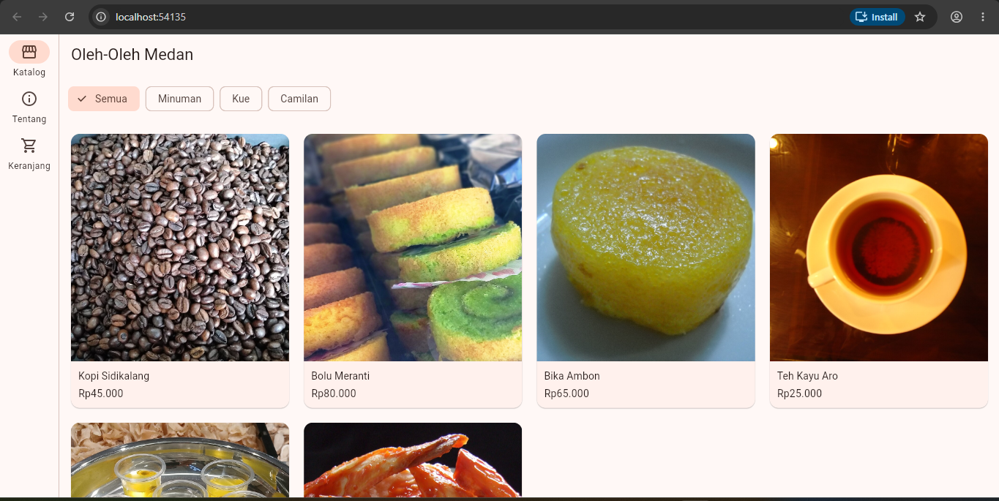
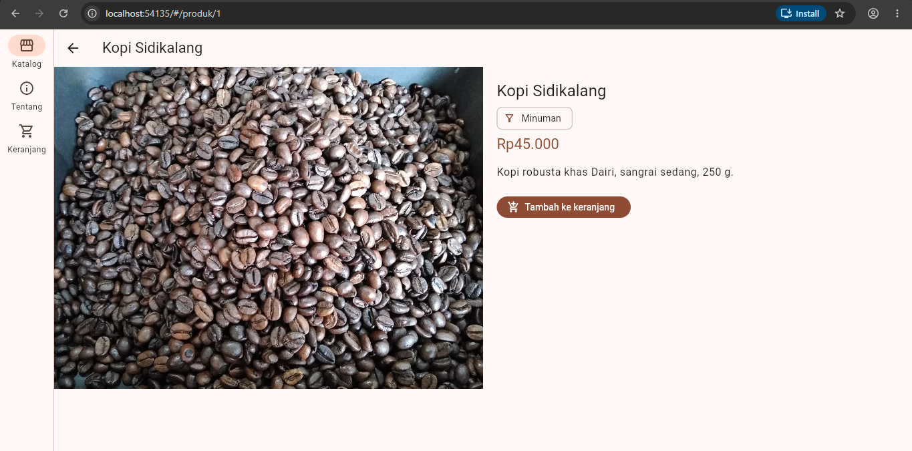
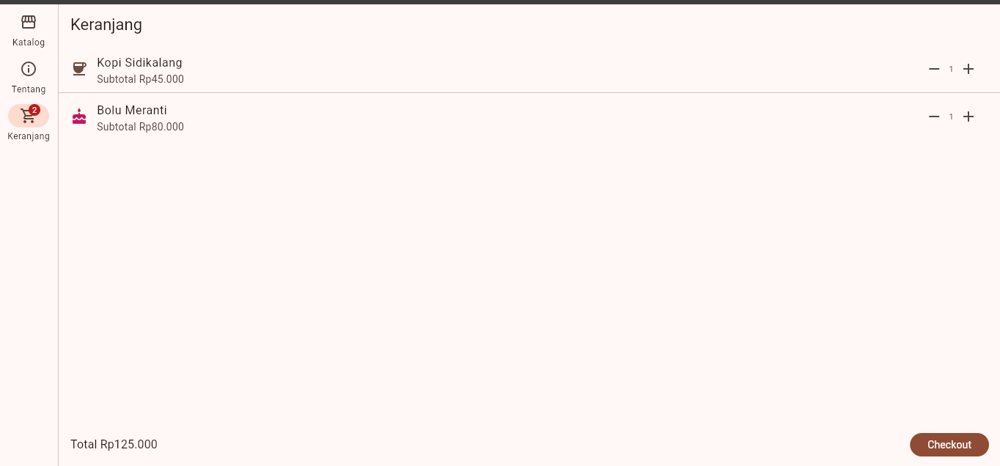
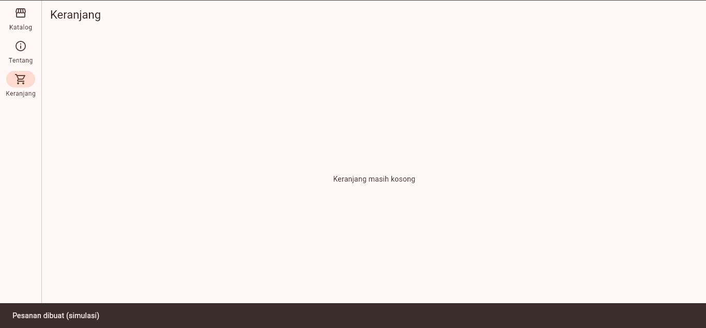
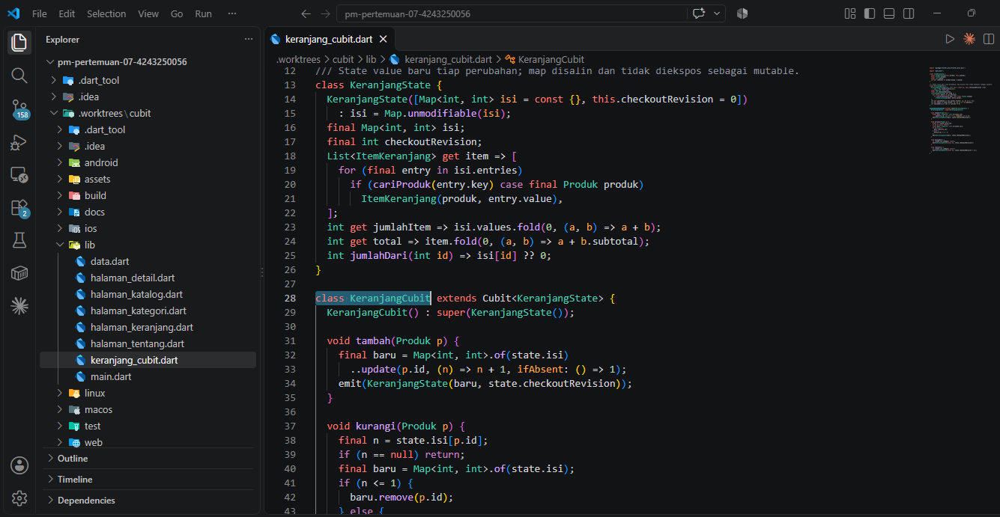
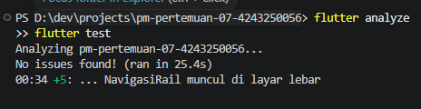

# Praktikum Pertemuan 7 — State Management Flutter
## Katalog Oleh-Oleh Medan: Keranjang Belanja dengan Provider dan Cubit

**Micael Zecsen Saragih** · **4243250056** · **PSIK 24 D**  
Program Studi Ilmu Komputer · Universitas Negeri Medan  
Mata Kuliah: **Pemrograman Mobile** · Pertemuan 7

Aplikasi katalog oleh-oleh khas Medan yang dikembangkan dari praktikum Pertemuan 6. Fokus Pertemuan 7 adalah **pengelolaan state keranjang belanja** menggunakan dua pendekatan: **Provider (ChangeNotifier)** dan **Cubit (flutter_bloc)**. Kedua pendekatan ditulis pada branch yang berbeda karena **fitur dan tampilan yang dituju sama, tetapi mekanisme pembaruan state berbeda**.

> **Keterangan data:** Produk dan harga merupakan data simulasi untuk praktikum, bukan katalog penjualan resmi. Foto adalah ilustrasi yang tidak selalu mewakili produk/merek asli.

## 1. Pilihan Implementasi

| Branch | State management | Berkas utama | Tautan |
|---|---|---|---|
| `main` | Provider — versi utama yang didokumentasikan | `lib/keranjang_model.dart` | [Lihat main](https://github.com/micaelsaragih/pm-pertemuan-07-4243250056/tree/main) |
| `keranjang-provider` | `ChangeNotifierProvider` + `KeranjangModel` | `lib/keranjang_model.dart` | [Lihat Provider](https://github.com/micaelsaragih/pm-pertemuan-07-4243250056/tree/keranjang-provider) |
| `keranjang-cubit` | `BlocProvider` + `KeranjangCubit` | `lib/keranjang_cubit.dart` | [Lihat Cubit](https://github.com/micaelsaragih/pm-pertemuan-07-4243250056/tree/keranjang-cubit) |

> Screenshot antarmuka 01–04 diambil dari Provider, sedangkan screenshot 05 memperlihatkan source code Cubit. Penggunaan screenshot UI Provider **tidak berarti** hasil runtime Cubit sudah dibuktikan oleh gambar tersebut.

## 2. Fitur Aplikasi

- Katalog **6 produk**: Kopi Sidikalang, Bolu Meranti, Bika Ambon, Teh Kayu Aro, Sirup Markisa, dan Keripik Ubi Balado.
- Foto produk lokal dalam `assets/images/`, menggunakan `Image.asset`, `BoxFit.cover`, serta ikon cadangan bila foto gagal dibaca.
- Filter kategori menggunakan `FilterChip`, halaman kategori, detail produk, dan animasi `Hero`.
- Navigasi berbasis `go_router`; `NavigationBar` untuk layar sempit dan `NavigationRail` pada lebar **840 dp atau lebih**.
- Grid katalog responsif mengikuti lebar ruang yang tersedia.
- Keranjang: **tambah produk, kurangi jumlah, subtotal per item, total harga, badge jumlah barang**, serta checkout simulasi.
- Checkout mengosongkan keranjang dan menampilkan `SnackBar`. **Tidak ada transaksi atau pembayaran sungguhan.**
- Unit test logika keranjang dan widget test antarmuka.

## 3. Dokumentasi Screenshot

Enam screenshot berikut telah tersedia di folder `docs/`. Empat gambar pertama merekam penggunaan aplikasi Provider; gambar kelima menjelaskan kode Cubit; gambar keenam menjadi bukti pemeriksaan dan pengujian lokal.

### 01 — Katalog Provider

Katalog produk dengan foto ilustrasi, harga, kategori, dan navigasi menuju keranjang.



### 02 — Detail Produk Provider

Halaman detail menampilkan informasi produk dan aksi **Tambah ke Keranjang**.



### 03 — Keranjang Provider

Daftar barang, pengaturan jumlah menggunakan tombol **+ / −**, subtotal, dan total belanja.



### 04 — Checkout Provider

Bukti proses checkout simulasi beserta notifikasi `SnackBar`.



### 05 — Implementasi Source Code Cubit

Bukti kode pada branch `keranjang-cubit`. Perhatikan `KeranjangCubit`, representasi `KeranjangState`, serta pemanggilan `emit()` saat isi keranjang diperbarui.



Source asli dapat dilihat di [`keranjang-cubit/lib/keranjang_cubit.dart`](https://github.com/micaelsaragih/pm-pertemuan-07-4243250056/blob/keranjang-cubit/lib/keranjang_cubit.dart).

### 06 — Hasil Analisis dan Pengujian

Screenshot terminal hasil pemeriksaan `flutter analyze` dan `flutter test` pada komputer mahasiswa. Angka dan status pengujian mengikuti bukti tersebut; README ini tidak mengklaim menjalankan ulang Flutter di GitHub.



## 4. Perbandingan Provider dan Cubit

| Aspek | Provider | Cubit |
|---|---|---|
| Pengelola state | `KeranjangModel extends ChangeNotifier` | `KeranjangCubit extends Cubit<KeranjangState>` |
| Data keranjang | `Map<int, int>` di model, dimutasi melalui metode | State baru dibuat ketika isi keranjang berubah |
| Mengirim perubahan | `notifyListeners()` | `emit(stateBaru)` |
| Memasang pengelola | `ChangeNotifierProvider` | `BlocProvider` |
| Membaca state pada widget | `context.watch` / `context.select` | `BlocBuilder` / `BlocConsumer` / `context.select` |
| Menjalankan aksi | `context.read<KeranjangModel>()` | `context.read<KeranjangCubit>()` |
| Fokus pengujian | Mutasi data dan notifikasi listener | Transisi state/hasil aksi Cubit |

**Kesimpulan:** Provider cocok untuk implementasi sederhana dengan `ChangeNotifier` dan `notifyListeners()`. Cubit memisahkan perubahan menjadi state yang diterbitkan secara eksplisit dengan `emit()`. Perbedaan utamanya **bukan pada UI**, melainkan pada struktur dan alur pengelolaan state.

## 5. Alur Penggunaan Aplikasi

```text
Katalog Produk
   ├── Filter kategori
   └── Pilih produk → Detail Produk
                        └── Tambah ke Keranjang
                                  ↓
                             Badge bertambah
                                  ↓
                           Halaman Keranjang
                            ├── Tambah (+)
                            ├── Kurangi (−)
                            ├── Subtotal
                            ├── Total
                            └── Checkout
                                  ↓
                        Kosongkan keranjang
                        + tampilkan SnackBar
```

Rute yang digunakan antara lain `/`, `/produk/:id`, `/kategori/:nama`, `/tentang`, dan `/keranjang`.

## 6. Struktur Project (branch utama)

```text
pm-pertemuan-07-4243250056/
├── lib/
│   ├── main.dart
│   ├── data.dart
│   ├── keranjang_model.dart
│   ├── halaman_katalog.dart
│   ├── halaman_detail.dart
│   ├── halaman_kategori.dart
│   ├── halaman_keranjang.dart
│   └── halaman_tentang.dart
├── assets/images/
│   ├── kopi_sidikalang.jpg
│   ├── bolu_meranti.jpg
│   ├── bika_ambon.jpg
│   ├── teh_kayu_aro.jpg
│   ├── sirup_markisa.jpg
│   └── keripik_ubi_balado.jpg
├── test/
│   ├── keranjang_test.dart
│   └── widget_test.dart
├── docs/
│   ├── 01-provider-katalog.png
│   ├── 02-provider-detail.png
│   ├── 03-provider-keranjang.png
│   ├── 04-provider-checkout.png
│   ├── 05-cubit-source.png
│   ├── 06-analyze-test.png
│   └── KREDIT_FOTO.md
├── android/ · ios/ · web/ · windows/ · linux/ · macos/
├── pubspec.yaml
└── README.md
```

Pada branch Cubit, `lib/keranjang_model.dart` diganti pendekatannya oleh `lib/keranjang_cubit.dart`, dan dependensi utama pengelolaan state menggunakan `flutter_bloc`.

## 7. Cara Menjalankan

**Persyaratan:** Flutter SDK yang sesuai dengan `pubspec.yaml` dan Chrome jika ingin menguji Flutter Web.

```powershell
git clone https://github.com/micaelsaragih/pm-pertemuan-07-4243250056.git
cd pm-pertemuan-07-4243250056
flutter pub get
flutter analyze
flutter test
flutter run -d chrome
```

Jika lingkungan jaringan menghambat pengunduhan sumber daya Flutter Web, pada versi Flutter yang mendukung opsi tersebut dapat dicoba:

```powershell
flutter run -d chrome --release --no-web-resources-cdn
```

Untuk memeriksa Cubit, dari salinan repository yang tidak memiliki perubahan lokal belum disimpan:

```powershell
git switch keranjang-cubit
flutter pub get
flutter analyze
flutter test
flutter run -d chrome
```

**Perhatian:** Jangan melakukan `git switch` jika branch sudah dipakai worktree lain. Pada konfigurasi dengan `.worktrees/cubit`, buka folder worktree tersebut langsung. Simpan perubahan lokal sebelum berpindah branch. Branch Cubit perlu diuji secara mandiri; hasil pengujian pada Provider tidak otomatis membuktikan Cubit lulus.

## 8. Sumber dan Lisensi Foto

Keenam foto merupakan ilustrasi representatif yang diperoleh dari Wikimedia Commons dan **tidak diklaim sebagai foto resmi produk bermerek**. Sebagian foto memiliki lisensi CC BY/CC BY-SA; informasi sumber, atribusi, dan catatan penggunaan dicantumkan di [`docs/KREDIT_FOTO.md`](docs/KREDIT_FOTO.md).

**Catatan publikasi:** Status lisensi foto `sirup_markisa.jpg` masih ditandai perlu verifikasi pada berkas kredit. Foto tersebut tidak boleh dianggap memiliki izin redistribusi yang telah dipastikan sampai halaman sumber dan lisensinya diperiksa.

## 9. Catatan Penggunaan AI

AI digunakan sebagai bantuan dalam pembuatan source code, dokumentasi, dan penjelasan konsep. Pengujian melalui Flutter serta screenshot praktik dilakukan dan diperiksa pada perangkat mahasiswa.

---

**Repository:** [micaelsaragih/pm-pertemuan-07-4243250056](https://github.com/micaelsaragih/pm-pertemuan-07-4243250056)  
**Identitas:** Micael Zecsen Saragih · 4243250056 · PSIK 24 D
